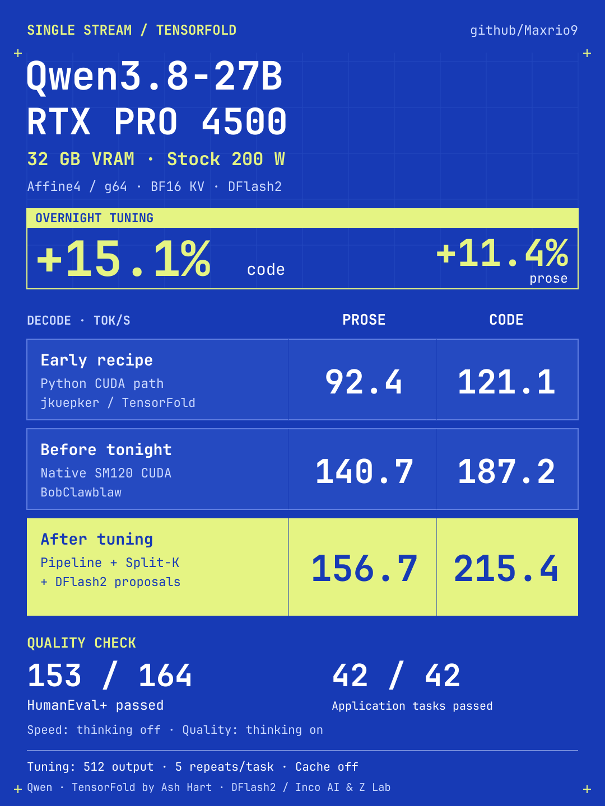

# Qwen3.8-27B: single-stream tuning on RTX PRO 4500

A profiling-led TensorFold adaptation improves single-stream decode by **11.4% on prose and 15.1% on code** against fresh matching controls on a stock 200 W RTX PRO 4500 Blackwell. The tuned recipe keeps the same affine4/g64 target and BF16 KV as the native baseline, with DFlash2 speculation.

[Build and run](REPRODUCE.md) · [Pinned recipe](recipe.json) · [Engine patch](source/tunable-v13.patch) · [Evidence](evidence/) · [Native benchmark receipts](receipts/) · [Credits](../CREDITS.md)

## The results in the graphic

| Recipe stage | Prose decode, tok/s | Code decode, tok/s | Recipe foundation |
|---|---:|---:|---|
| Early Python CUDA recipe | 92.4 | 121.1 | jkuepker / TensorFold |
| Native baseline, freshly retested | 140.7 | 187.2 | BobClawblaw native SM120 integration |
| Tuned single-stream | **156.7** | **215.4** | Native recipe + changes below |

**The overnight comparison** uses approximately 52–68 actual input tokens, 512 output tokens, thinking off, temperature 0.6/top_p 0.95/top_k 20/min_p 0/seed 42, zero penalties, zero cached tokens and 2048-token serving capacity. Each result is the mean of five measured repetitions after an excluded warmup. Decode excludes the complete first delivered text block. Whole-request throughput, variation, actual token counts and sampled memory peaks are preserved in [confirmation summaries](evidence/service-confirmation.json) and the individual [baseline](evidence/baseline-service-samples.json) / [tuned](evidence/tuned-service-samples.json) scalar samples. Sampled additional VRAM: about **20.79 GB baseline / 20.95 GB tuned**.

The early point is a separate historical measurement: three repetitions, 4096-token capacity and an SC5 EXL3 target through the Python CUDA path. Moving to native SM120 CUDA also changed the checkpoint and setup. It is not an isolated Python-versus-native ablation; the headline percentages compare only the fresh native before/after controls. [Historical provenance](evidence/historical-point.json).

## What changed

- **Small-row matrix pipeline, eight → four staging buffers.** The original single-stream trace spent 86.4% of summed GPU kernel time in affine4 target/drafter matrix work. Lower shared-memory pressure helped the small-row path. Static residency prediction improved; that is not a measurement of physical occupancy.
- **Split-K dispatch threshold, 192 → 128.** Less unnecessary splitting/reduction work on this 82-SM card. This changes FP32 reduction grouping. Real-weight checks found at most 0.0391% differing BF16 outputs in the checked cases, within predeclared FP64 error bounds; it is not bit-identical by construction.
- **DFlash proposal scale, 1.5 → 2**, with auxiliary/KV projection pairing enabled. Proposal scale changes draft ranking, not target sampling temperature. Verification block 16, four branches and the default noise/edge settings remain.

The [standalone patch](source/tunable-v13.patch) is the exact measured experimental build patch. It also exposes inactive tuning alternatives; the [descriptor](recipe.json) explicitly freezes their settings. Target weights, target quantization and BF16 KV were not changed between the fresh native baseline and tuned result. The native loader quantizes draft projections to affine4, so a downloaded BF16 drafter does not imply all-BF16 draft execution.

Six prompts were declared before tuning and used only after settings were frozen. Across those held-out workloads, mean client decode increased **185.4 → 204.3 tok/s**, with whole-request output throughput **179.9 → 197.7 tok/s**, 12/12 successful fixed-budget requests per profile. These equal-weight means describe that six-prompt mix. [Validation summaries](evidence/validation-summary.json).

## Quality checked separately

| Profile | HumanEval+ | Application tasks |
|---|---:|---:|
| Native baseline | 152 / 164 | 42 / 42 |
| Tuned single-stream | **153 / 164** | **42 / 42** |

These are separate **thinking-on, temperature-1, low-effort** evaluations at 8192-token capacity with a 4096-token reply budget and natural EOS. Each task gets one response, without retries or code repair. Applications cover extraction/JSON (12), grounded questions (12), instruction following (12), and planning/arithmetic (6). The deterministic [fixtures/scorer](validation/application-fixtures.py) are included. Coding uses all official HumanEval+ v0.1.10 test inputs through pinned EvalPlus, not only the original HumanEval tests; [grader](validation/grade.py), [dataset/source pin](evidence/quality-source.json), [task-level grades/hashes](evidence/quality-summary.json) and [paired disagreements](evidence/full164-paired-quality.json) are included.

One tuned coding answer reached the token limit; its original score is retained. The canonical HumanEval/32 residual-test exception is documented without changing official tests. A one-task aggregate difference establishes neither quality superiority nor universal numerical equivalence. This is validation against the same affine4 target, not a BF16/EXL3 accuracy comparison. Generated responses and private runtime logs are not published.

## Standard 256-output receipts

These are a different fixture from the 512-output graphic: 31 chat / 14 code input tokens, 256 output tokens, five measured repetitions, zero prefix reuse, 2048-token capacity. Values are medians of client-delivery rates; temperatures remain separate.

| Profile | Temperature | Chat decode | Code decode |
|---|---:|---:|---:|
| Native baseline | 0 | 142.3 | 198.4 |
| Tuned | 0 | **158.6** | **214.2** |
| Native baseline | 1 | 133.2 | 233.0 |
| Tuned | 1 | **141.4** | **266.2** |

[Baseline receipt](receipts/baseline-community-v1.json) · [Tuned receipt](receipts/tuned-community-v1.json) · [Binary/patch provenance](receipts/provenance.json).

The two native receipts are preserved byte-for-byte. The executable still reports version 1.0.12; the tuned executable is modified, identified by its patch and binary hashes. These are public supporting measurements, **not newly submitted or approved leaderboard results**. A passing receipt-schema check alone does not imply upstream endorsement.

## Explicitly labelled custom-engine receipt

A fresh follow-up receipt uses runtime version **1.0.12+4500v13** so the leaderboard can display that it is a modified build. The inference patch and selected policy are unchanged. A separate [metadata-only build patch](source/version-label.patch) permits this one label through the upstream build script’s strict MAJOR.MINOR.PATCH check. Apply it after `tunable-v13.patch`, then build with `-Dversion=1.0.12+4500v13`.

[Fresh standard receipt](receipts/tuned-custom-version-community-v1.json) · [Binary/patch hashes, conditions and cell summaries](evidence/custom-version-receipt.json). These follow-up timings have the desktop active and stay separate from the morning 512-output graphic. The earlier receipt bytes and graphic remain unchanged. This explicitly labelled receipt is **approved on the [TensorFold leaderboard](https://tensorfold.dev/benchmarks?result=d2649b12-c025-49eb-b686-3b2b6f40b60a)** under Maxrio9: greedy chat **152.9 tok/s**, greedy code **206.8 tok/s**. [Publication record](receipts/publication.json). All 20 server-supplied shortened token hashes matched the earlier tuned standard receipt; this finite check is not a universal equivalence proof.

## Hardware and scope

RTX PRO 4500 Blackwell, 32 GB, 82 SMs, stock 200 W; Compute Mode Default, ECC off, no clock changes. AM4 Ryzen 9 5900X, 32 GB DDR4-3200 and a PCIe Gen3 ×16 riser. Displays were externally disabled before this focused extension; older published receipts had active displays. Fresh native before/after controls share the extension's conditions. No controlled display-state, Compute Mode or RTX 5090 comparison was performed here.

Additional sampled GPU allocation stayed below the 28-decimal-GB allowance, with a 26000 MiB growth guard. Sampled telemetry can miss brief transients; engine admission settings are not hard allocator quotas. The release focuses on the qualified single-stream recipe. Concurrency policies and the larger-prefill allocation prototype remain separate experiments.

## Shareable graphic

[PNG](assets/qwen-rtx-pro-4500.png) · [Editable SVG](assets/qwen-rtx-pro-4500.svg). Model, engine and recipe authors retain credit; these measurements and adaptations build on their work.
